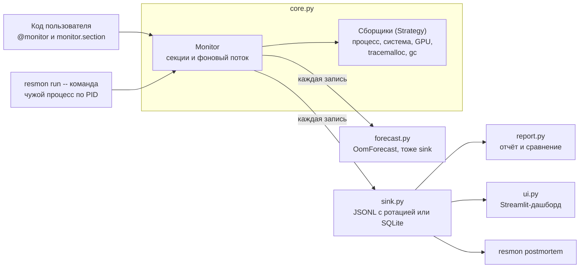
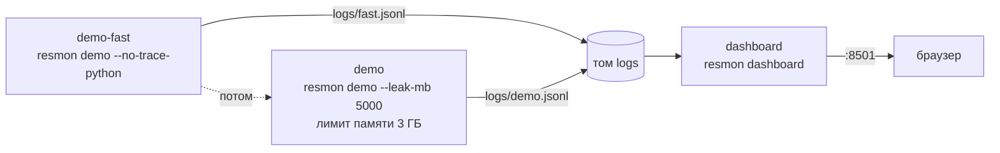

# resmon - монитор ресурсов для ML-задач

[](https://github.com/MichaelToschenko/ml_resource_monitor_homework/actions/workflows/ci.yml)
[](https://github.com/MichaelToschenko/ml_resource_monitor_homework/tree/python-coverage-comment-action-data)
[](https://hub.docker.com/r/mikhailtoshchenko/resmon)

Библиотека, которая показывает, сколько ресурсов съедает каждый кусок ML-кода: процессор, память программы и всей машины, видеокарта, диск, сеть, память под объекты Python и работа сборщика мусора. Код размечается декоратором или контекст-менеджером, замеры идут в фоновом потоке и пишутся в JSON-лог с ротацией. По логу строится отчёт по секциям и живой дашборд в Streamlit.

Изюминка проекта - **прогноз нехватки памяти**. Монитор строит тренд занятой памяти и заранее предупреждает: "память кончится примерно через 30 с". После падения команда `resmon postmortem` разбирает лог и показывает, успел ли прогноз предупредить. Идея пришла из своей исследовательской работы по world-моделям, где обучение на арендованной видеокарте однажды упало от нехватки памяти, и в логе не осталось ни строчки.

## Задача

Тема "Монитор ресурсов для ML-задач": библиотека-декоратор и контекст-менеджер, CPU/RAM/GPU/диск, tracemalloc, статистика сборщика мусора, опрос в фоновом потоке, структурированные JSON-логи с ротацией, отчёт по секциям и живой Streamlit-дашборд. Своя модель не нужна, наблюдаем за любым инференсом. В демо это эмбеддинги отзывов о фильмах моделью `intfloat/multilingual-e5-small` через sentence-transformers на CPU.

## Запуск одной командой

Нужен Docker с Compose v2. Образ готовый, он скачается с Docker Hub:

```bash
docker compose up
```

Что произойдёт:

1. Контейнер `demo-fast` делает короткое демо: скачивает 500 отзывов IMDB с Hugging Face, загружает модель, считает эмбеддинги пачками и ищет отзывы, похожие на запрос "страшный фильм ужасов с кровью". Память объектов Python он не отслеживает и пишет лог `logs/fast.jsonl`. Это около 20 секунд.
2. Сразу после него контейнер `demo` делает то же самое, но с tracemalloc, а в конце начинает утечку памяти по 20 МБ/с. У контейнера лимит 3 ГБ, примерно через 2 минуты Docker его убивает (код 137, OOMKilled). Секунд за 30 до этого в логе появляется предупреждение прогноза. Демо идут по очереди, а не вместе, чтобы не делить процессор и честно сравниваться.
3. Контейнер `dashboard` всё это время показывает живой дашборд на http://localhost:8501: плитки, графики памяти и CPU, обратный отсчёт до нехватки памяти и пламенный граф секций. Слева можно выбрать запуск и второй запуск для сравнения. Если выбрать `demo.jsonl` и сравнить с `fast.jsonl`, внизу видно, что tracemalloc замедлил загрузку модели примерно в 5 раз (3 с против 17 с), а на эмбеддинги почти не повлиял.

После падения можно разобрать лог:

```bash
docker compose run --rm dashboard postmortem logs/demo.jsonl
```

```
... сначала таблица по секциям, как в resmon report ...
Запуск оборвался, последняя секция: leak
Занято памяти: 3072 из 3072 МБ
Прогноз предупредил за 31 с
```

Остановить всё: `Ctrl+C`, потом `docker compose down`.

## Как пользоваться в своём коде

Установка в свой проект:

```bash
uv add "resmon[ui] @ git+https://github.com/MichaelToschenko/ml_resource_monitor_homework.git"
```

Библиотеке самой по себе нужны только `psutil`, `numpy`, `rich`, `typer` и `httpx`. Тяжёлое вынесено в наборы: `[demo]` (torch и sentence-transformers, нужен для `resmon demo`), `[ui]` (Streamlit и Plotly, нужен для `resmon dashboard`) и `[gpu]` (nvidia-ml-py). Для разработки в клоне репозитория: `uv sync --all-extras`.

```python
from rich import print

from resmon.core import Monitor
from resmon.forecast import OomForecast
from resmon.report import section_stats, stats_table
from resmon.sink import JsonlSink

# Прогноз нехватки памяти - тоже sink, он получает каждую запись монитора
monitor = Monitor(interval=0.5, sinks=[JsonlSink("logs/train.jsonl"), OomForecast()])


@monitor("embed")  # каждый вызов функции станет секцией
def embed(texts): ...


with monitor:
    with monitor.section("load"):
        with monitor.section("read"):  # вложенная секция load/read
            rows = read_dataset()
        with monitor.section("parse"):
            texts = parse(rows)
    embed(texts[:1000])
    embed(texts[1000:])

print(stats_table(section_stats(monitor.records)))
```

Команды в терминале:

| Команда | Что делает |
|---|---|
| `resmon demo [--texts 500] [--leak-mb 0] [--no-trace-python]` | демо-нагрузка под монитором, в конце отчёт. Без tracemalloc программа быстрее, но нет памяти объектов Python |
| `resmon run -- python train.py` | запускает чужую программу и следит за ней снаружи, код выхода передаётся дальше |
| `resmon report logs/demo.jsonl` | отчёт по секциям из лога |
| `resmon compare old.jsonl new.jsonl` | сравнение двух запусков: было, стало и изменение в процентах |
| `resmon postmortem logs/demo.jsonl` | чем кончился запуск и за сколько секунд прогноз предупредил о нехватке памяти |
| `resmon dashboard --log logs/demo.jsonl` | живой дашборд в браузере |

Лог можно писать в JSONL (`--log run.jsonl`) или в SQLite (`--log run.db`). Модель для демо задаётся переменной окружения `RESMON_MODEL`.

Пример отчёта для такого кода (колонки диска и сети здесь обрезаны):

```
секция      │ вызовы │ время, с │ доля, % │ CPU, % │ RAM пик, МБ │ Python пик, МБ │ GC, мс
весь запуск │ -      │ 3.9      │ 100.0   │ 99.2   │ 431.6       │ 217.6          │ 0.0
load        │ 1      │ 2.0      │ 50.8    │ 98.9   │ 431.6       │ 217.6          │ 0.0
  read      │ 1      │ 1.9      │ 48.6    │ 98.8   │ 420.1       │ 217.6          │ 0.0
  parse     │ 1      │ 0.1      │ 1.5     │ 99.8   │ 431.6       │ 217.6          │ 0.0
embed       │ 2      │ 1.8      │ 46.1    │ 99.5   │ 222.7       │ 0.2            │ 0.0
```

## Архитектура



В Docker Compose три контейнера из одного образа и общий том с логами:



| Модуль | Что внутри |
|---|---|
| `core.py` | сборщики метрик, фоновый опрос, секции и декоратор |
| `sink.py` | запись в JSONL с ротацией и в SQLite, чтение обратно, JSON-формат логов программы |
| `report.py` | итоги по секциям в виде дерева и сравнение запусков |
| `forecast.py` | тренд памяти, время до лимита, предупреждения и разбор после падения |
| `demo.py` | демо-нагрузка: тексты по HTTP, эмбеддинги, поиск, утечка |
| `cli.py` | команды `resmon` |
| `ui.py` | дашборд |
| `research.py` | опыты для раздела "Исследование" |

## Почему сделано так

- **Сборщики как паттерн Strategy.** У всех один интерфейс `start/stop/collect`, монитор опрашивает их одинаково. Видеокарта подключается, только если есть драйвер NVIDIA, для чужого процесса просто не берутся tracemalloc и gc. В тестах любой сборщик легко подменить заглушкой.
- **Поток, а не отдельный процесс.** tracemalloc и статистика сборщика мусора доступны только изнутри процесса. Цена потока измерена: при замере раз в 0.1-1 с это 2-6 %, если выключить tracemalloc (см. исследование).
- **Каждый замер помечен секцией.** Замер делается и на входе в секцию, и на выходе, поэтому даже короткая секция попадает в отчёт. Отчёт считается по этим меткам, а не по записям о закрытии секций, поэтому секция, внутри которой процесс убили, тоже видна в отчёте.
- **JSONL через logging и RotatingFileHandler.** Каждая строка сразу отдаётся системе, поэтому лог переживает даже kill -9, а ротация не даёт ему съесть диск. Оборванная последняя строка при чтении пропускается. SQLite сделан как второй вариант хранилища, в режиме WAL, чтобы дашборд читал базу и не мешал записи.
- **Дашборд читает тот же файл.** Между контейнерами нет ни сервера, ни базы, только общий том. Дашборд работает и после смерти программы, а этот момент как раз самый интересный.
- **Модель внутри процесса, а не через HTTP API.** Общее правило курса про OpenAI-совместимый API рассчитано на проекты, которые сами общаются с моделью. Здесь модель только подопытная нагрузка, а схема темы прямо называет sentence-transformers на CPU. Так монитор видит настоящую нагрузку процесса. Имя модели всё равно задаётся через `RESMON_MODEL`, а внешний HTTP-сервис (тексты с Hugging Face) в тестах подменяется через respx.
- **Прогноз только на простых моделях.** Прямая по последним 10 секундам занятой памяти, тянется вперёд не дальше трёх окон (30 с). Если точка уходит от тренда больше чем на 100 МБ, это скачок, например загрузилась модель, а не утечка, и окно начинается заново. Парабола видит разгон раньше, но на шуме даёт ложные тревоги, поэтому по умолчанию прямая. Это проверено в исследовании.
- **Память считается как в docker stats.** В контейнере берётся `memory.current` минус неактивный файловый кэш против `memory.max` из cgroup, вне контейнера занятая память всей машины против всей памяти.
- **Docker.** Модель скачивается при сборке, демо работает без интернета. torch ставится в CPU-версии, так образ в несколько раз меньше. Внутри обычный пользователь, а не root. У демо `memswap_limit` равен лимиту, иначе вместо падения контейнер ушёл бы в своп и просто тормозил.

## Исследование

Скрипт `uv run python research.py` (около 40 секунд) печатает таблицы ниже. Цифры с MacBook на Apple Silicon.

**Цена замеров.** Нагрузка - 10 раз по миллиону мелких словарей, медиана из трёх запусков.

| режим | время, с | замедление, % |
| --- | --- | --- |
| без монитора | 0.94 | +0 |
| замер раз в 1.0 с | 0.96 | +2 |
| замер раз в 0.1 с | 1.00 | +6 |
| замер раз в 0.01 с | 1.15 | +22 |
| раз в 0.1 с и tracemalloc | 7.09 | +655 |

Опрос раз в 0.1-1 с почти незаметен, раз в 0.01 с уже замедляет на пятую часть. Самое дорогое - tracemalloc: он следит за каждым выделением памяти и замедляет код в 7 раз. Поэтому его можно выключить: `default_collectors(trace_python=False)` или `resmon demo --no-trace-python`. На настоящей нагрузке в Docker вышло так же: загрузка модели (это в основном импорт torch и transformers) с tracemalloc идёт 17 с вместо 3 с, а эмбеддинги почти не меняются, потому что тяжёлый расчёт внутри torch идёт мимо Python.

**Сборщик мусора и миллионы объектов.** Создаём N мелких списков и держим их в памяти, считаем сборки через `GcCollector` из resmon.

| объектов | время, с | сборок мусора | время сборок, мс |
| --- | --- | --- | --- |
| 1 млн | 0.12 | 1426 | 95 |
| 3 млн | 0.40 | 4279 | 331 |
| 5 млн | 0.78 | 7132 | 659 |

Сборщик запускается примерно раз на 700 новых объектов, и на это уходит большая часть времени создания объектов.

**gc.freeze() и выключение сборщика.** Сначала загружаем 5 млн долгоживущих объектов (как датасет), потом на горячем участке создаём ещё 2 млн. Время считаем двумя способами: только горячий участок и вместе с уборкой, которая случается после него, когда программа живёт дальше.

| приём | горячий участок, с | вместе с уборкой после, с | полных уборок |
| --- | --- | --- | --- |
| как есть | 0.22 | 0.23 | 1 |
| gc.disable() на горячем участке | 0.04 | 0.31 | 1 |
| gc.freeze() после загрузки | 0.21 | 0.21 | 4 |

Почти всё время уборки здесь съедает одна полная уборка, которая проверяет все объекты сразу, включая датасет. Мелкие уборки новых объектов почти бесплатны. Python запускает полную уборку, когда новых старых объектов набралось больше четверти от уже имеющихся.

`gc.disable()` ускоряет горячий участок в 5 раз, но уборка никуда не девается, а случается сразу после него, и в сумме выходит даже дольше. Смысл у него другой: выбрать, когда будет пауза, например не посреди обработки запроса, а между эпохами. Или программа завершится раньше, чем уборка вообще понадобится.

`gc.freeze()` убирает датасет из полных уборок, и каждая уборка становится меньше. Но старых объектов для сборщика теперь мало, порог в четверть срабатывает чаще, и полных уборок становится 4 вместо одной. В сумме почти без выигрыша. Вывод: в этом сценарии ни один приём не уменьшает общую цену уборки, а разобраться в этом помогли счётчики сборок по поколениям, которые собирает монитор.

**Прогноз нехватки памяти против простого порога 90 %.** Пять сценариев занятой памяти с шумом, по 10 случайных прогонов, лимит 3000 МБ. Для сценариев с падением показано, за сколько секунд до конца пришло устойчивое предупреждение, для остальных - сколько прогонов дали ложную тревогу.

| сценарий | порог 90 % | прямая | парабола |
| --- | --- | --- | --- |
| линейная утечка 20 МБ/с | за 15.1 ± 0.4 с | за 30.4 ± 1.2 с | за 45.0 ± 4.2 с |
| ускоряющаяся утечка | за 5.8 ± 0.3 с | за 20.1 ± 0.7 с | за 36.2 ± 3.6 с |
| пила: батчи и сборка мусора (ложные тревоги) | 0 из 10 | 0 из 10 | 10 из 10 |
| скачок: загрузилась модель (ложные тревоги) | 0 из 10 | 0 из 10 | 7 из 10 |
| ровная память (ложные тревоги) | 0 из 10 | 0 из 10 | 1 из 10 |

Прямая предупреждает в 2-3 раза раньше порога и без ложных тревог. Парабола ещё раньше, но ей нельзя верить на шуме. На настоящем запуске в Docker вышло так же: прогноз предупредил за 31-32 с, порог сработал бы примерно за 15 с.

## Тесты и качество кода

```bash
uv run pytest                    # 114 тестов, покрытие 99 %, порог в настройках 70 %
uv run pytest -m slow --no-cov   # тест с настоящей моделью, в CI не запускается
uv run pre-commit run --all-files  # ruff, ruff format, mypy --strict, uv.lock и мелкие проверки
```

- Фикстуры в `tests/conftest.py`: монитор с предсказуемыми метриками, заглушка модели эмбеддингов, подменённый сервис Hugging Face.
- Внешние сервисы подменяются: HTTP через respx (включая обрыв сети, 500, 429 и страницу прокси вместо данных), модель - заглушкой, psutil и pynvml - через monkeypatch.
- Много `parametrize`: страницы запроса, виды сбоев, сценарии прогноза, коды выхода.
- Есть тесты с настоящим поведением: программа правда занимает 200 МБ и монитор это видит, `resmon run` видит память чужого процесса, программу убивают сигналом 9, и `postmortem` пишет "оборвался".
- Дашборд проверяется через `streamlit.testing.v1.AppTest` без браузера.
- `print` запрещён правилом ruff T20, логи программы идут в JSON.
- CI в GitHub Actions на пуш в main и на pull request: зависимости строго по `uv.lock`, все хуки pre-commit, тесты, потом сборка образа под amd64 и arm64 и выкладка на Docker Hub из ветки main.

## Ограничения

- **Системные требования.** Docker с Compose v2, около 4 ГБ свободной памяти (лимит демо 3 ГБ) и около 4 ГБ на диске под образ. Видеокарта не нужна. Для разработки Python 3.12 и uv.
- **Внешние сервисы.** Docker Hub, чтобы скачать образ. API Hugging Face (datasets-server, без регистрации), чтобы скачать отзывы. Если сети нет, демо берёт несколько встроенных отзывов. Модель уже внутри образа.
- **Видеокарта** поддерживается только NVIDIA через pynvml. На настоящей видеокарте это не проверялось, в тестах pynvml подменяется.
- **Прогноз** видит только постепенный рост памяти. Резкий скачок одним куском предсказать по прошлым замерам нельзя никакой моделью. Вне контейнера прогноз смотрит на память всей машины, поэтому на него влияют другие программы, например браузер. Лимит контейнера читается из cgroup v2. Это Docker Desktop и все современные Linux, на старых системах с cgroup v1 лимит контейнера не виден, прогноз считает по памяти всей машины и предупредит слишком поздно.
- **Диск и сеть** считаются по всей машине, а не по процессу (на macOS psutil не даёт диск по процессу).
- **Секции** рассчитаны на один поток. Открывать их одновременно из нескольких потоков нельзя.
- **tracemalloc** заметно замедляет программу, и если он был включён до монитора, монитор выключит его при остановке.
- **Память с дочерними процессами** суммируется по RSS, общие страницы между процессами могут посчитаться дважды.
- **"RAM пик" программы может быть больше лимита контейнера.** RSS включает файлы библиотек и модели, отображённые в память, а Docker не засчитывает их контейнеру как обычную память. С лимитом сравнивается только "занято", поэтому прогноз работает по нему.
- **Монитор держит все записи в памяти**, чтобы в конце построить отчёт. Одна запись занимает около 1.4 КБ, при замере раз в 0.5 с это около 10 МБ в час. Для очень долгих запусков стоит увеличить интервал.
- **Код выхода 137** у контейнера `demo` в этой демонстрации означает нехватку памяти. Остановка по Ctrl+C даёт обычный код, потому что в compose включён `init`.

## Структура

```
src/resmon/          библиотека: core, sink, report, forecast, demo, cli, ui
tests/               тесты, общие фикстуры в conftest.py
research.py          опыты для раздела "Исследование"
Dockerfile           образ: Python 3.12, зависимости по uv.lock, модель внутри
docker-compose.yml   demo с лимитом памяти и dashboard
.github/workflows/   CI: проверки, тесты, образ на Docker Hub
```

Собрать образ самому: `docker build -t mikhailtoshchenko/resmon .`
